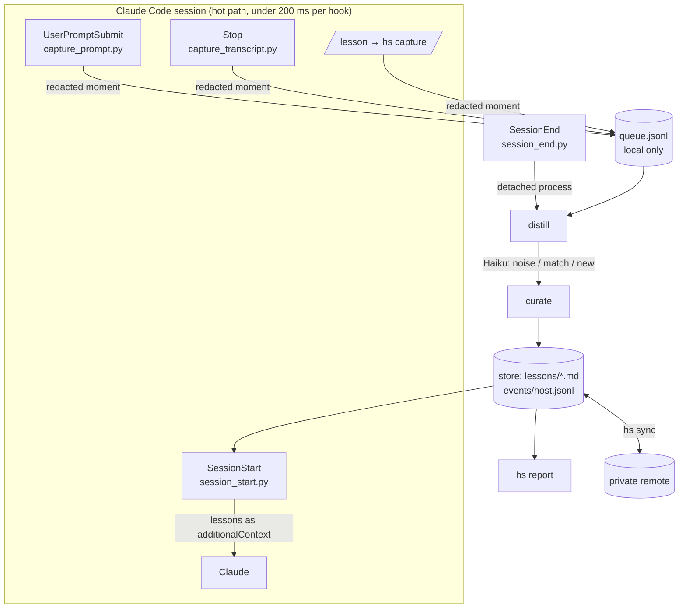
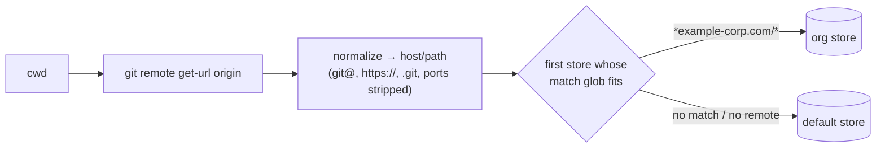

# Architecture: ai-toolkit / hindsight

This document covers how `ai-toolkit` is put together and how its first module, **hindsight**, works internally. If you only want to use the module, start with `modules/hindsight/README.md`.

## 1. Goals and constraints

hindsight is self-improving memory for Claude Code. It learns from the moments when the developer pushes back on Claude, and it shows with data whether that learning reduces repeat pushbacks.

| Constraint | How the design meets it |
|---|---|
| Curated memory, not a dump | Corrections become *candidate* lessons. They only take effect once the same correction shows up in two separate sessions. Near-duplicates are merged. Each scope holds at most 50 active lessons. Lessons that go unused, or don't help, are retired. |
| The developer can see, edit and delete every lesson | Lessons are plain Markdown in a git repo. Hand edits are detected and respected (the lesson is pinned). `hs` has a command for every lifecycle action. |
| No secrets or raw prompts stored | Only the sentence that carried the correction is kept (≤200 chars). It is redacted before it is written. Rejected edits keep the tool name and file extension, never the diff. `hs sync` scans for secrets and refuses to push if it finds any. |
| Local single-developer prototype | Python 3.9 standard library only, plus git and the `claude` CLI. State lives under `~/.claude`, `~/.config` and `~/.local/state`. |
| Portable, with memory kept apart from code | The code repo is public and contains no data. Memory lives in separate private git repos, and each repo's lessons go to a store chosen from its git remote. |

**Non-goals for the prototype:** sharing lessons across a team, real-time sync, embeddings or vector search, and a UI beyond the CLI.

## 2. System context

```mermaid
flowchart LR
  dev([Developer]) -- prompts / rejects edits --> cc[Claude Code]
  cc -- hook events --> hs[hindsight hooks]
  hs -- additionalContext --> cc
  hs -- claude -p --model haiku --> haiku[(Haiku)]
  hs <--> stores[(Memory stores<br/>git repos)]
  stores -- hs sync --> remotes[(Private remotes<br/>org / personal)]
  dev -- hs CLI / $EDITOR --> stores
```

Claude Code is the host. hindsight never patches it. It integrates only through:
- **hooks** registered in `~/.claude/settings.json`;
- **one slash command**, `/lesson`;
- **headless `claude -p`** calls during distill.

## 3. Repository layout

```
ai-toolkit/
  install.sh / uninstall.sh   idempotent; add or remove only entries tagged "/.claude/ai-toolkit/"
  lib/settings_merge.py       merges or removes hook entries in settings.json (shared by all modules)
  docs/ARCHITECTURE.md        this file
  modules/hindsight/
    module.json               manifest: hooks (event, script, timeout, step), CLI, commands
    setup.sh                  writes the default machine config and initializes the stores
    hooks/                    thin entry points; each one catches every error and exits 0
      capture_prompt.py       UserPromptSubmit
      capture_transcript.py   Stop
      session_end.py          SessionEnd   → starts distill in the background
      session_start.py        SessionStart → injects lessons
    lib/                      all logic; hooks and CLI import from here
      common.py               config, paths, repo detection, routing, locked JSONL IO, clock
      detect.py               scored regex correction detector
      redact.py               secret / PII redaction + pre-push scanner
      capture.py              redact → route → dedupe → append to the queue
      store.py                memory-store git repo: init, commit, events path
      lessons_md.py           Lesson model ↔ Markdown, scope→file mapping, Jaccard similarity
      events.py               append-only event log, merge alias resolution
      stats.py                replays events → per-lesson and per-session statistics
      llm.py                  wrapper around `claude -p` + tolerant JSON extraction
      distill.py              queue → moments → lessons (LLM, with rule-based fallback)
      curate.py               hand-edit detection, merge, consolidate, promote, retire, cap
      inject.py               choose relevant lessons within a budget and render them
      measure.py              report model and ASCII rendering
    bin/hs                    CLI (argparse); also the background distill entry point
    commands/lesson.md        /lesson slash command → `hs capture`
    tests/                    offline unittest suite, fake LLM, temporary HOME
```

**Module contract.** A module is a folder under `modules/` with a `module.json`. `install.sh` does the following for each module:
1. Symlinks `~/.claude/ai-toolkit` to the clone. All hook commands use `"$HOME/.claude/ai-toolkit/…"`, so `settings.json` does not depend on where the repo was cloned.
2. Links the CLI into `~/.local/bin` and the commands into `~/.claude/commands`.
3. Merges the hooks. `--steps N` registers only hooks whose step is ≤ N.
4. Runs `setup.sh`.

`settings.json` is backed up before every write. Uninstall removes only the tagged entries. Future modules (skills, agents, statusline, …) plug in the same way.

## 4. The loop



There are two paths:
- **Hot path:** the four hooks run synchronously inside the session. They use regex only, make no network calls, and can never block Claude.
- **Cold path:** distill and curate run in a detached background process after the session ends. These are the only steps that call the LLM.

### 4.1 Capture (step 1)

| Source | Hook | What is recorded |
|---|---|---|
| Typed correction ("no, use pnpm instead of npm") | UserPromptSubmit | the sentences that triggered the detector, the signals that fired, and the repo/store/langs |
| Rejected tool use | Stop | tool name, file extension, and the typed rejection reason (the text between `the user said:` and `Note:`) |
| `/lesson <text>` | CLI `hs capture` | the lesson text, `kind: explicit` |

**Detector** (`detect.py`). Each regex signal has a weight, and a prompt counts as a correction when the total reaches **2.0**. Examples:
- leading `no,` scores 2.0;
- `use X instead` scores 2.5;
- `I said` / `I told you` scores 2.5;
- `why did you` scores 2.0;
- a bare `instead` scores 1.0.

Negative patterns are removed before scoring, for example "no problem", "no-op", "don't know", "thanks". Prompts that start with `/` are skipped. In prompts longer than 1500 characters, only the first 500 are scanned.

Each signal is recorded, and step 5 uses this to report how precise each signal is.

**Transcript scanning** is incremental. `offsets.json` stores a byte offset per transcript. A partial final line is re-read on the next Stop. The offsets table is pruned once it has more than 200 entries. On a 47 MB transcript, the first scan takes about 0.4 s and later scans take about 0.13 s.

**Queue entry** (`~/.local/state/hindsight/queue.jsonl`):
```json
{"id":"…","ts":"…","session_id":"…","kind":"prompt|rejected_tool|explicit",
 "clause":"no, use pnpm instead of npm","signals":["lead_no","use_x_instead"],
 "repo":"gitlab.example-corp.com/team/web","store":"org","langs":["js"],
 "tool":"Edit","file_ext":".json"}
```
Every append takes an `fcntl` lock. The entry id is a short content hash, so if a hook fires twice the moment is stored once.

### 4.2 Distill (step 2)

`session_end.py` writes a `session` end event. It then starts `hs distill --quiet` in a new session with `HINDSIGHT_DISABLE=1`, so the nested `claude -p` doesn't trigger hindsight's own hooks. The hook returns immediately.

`distill.py` works like this:
1. Takes a **non-blocking run lock**. If another distill is already running, this one exits.
2. Snapshots the queue. If a rejection with no typed feedback is followed within 600 s by a correction prompt in the same session, the two are **pre-merged** into one moment.
3. Groups moments by **store**, then by **repo**. For each group it calls Haiku once. The input is the moments plus the existing lessons that apply to this repo or its languages (ID and text only). For each moment, Haiku returns one of:
   - `noise`;
   - `match` = an existing lesson ID;
   - `new` = a proposed lesson (imperative sentence of at most 120 characters, scope, keywords, file globs, confidence).

   Proposals with confidence below 0.5 are dropped.
4. **Fallback:** if the LLM call fails or its output can't be parsed, rule templates produce lessons such as `Use X instead of Y`, `Don't …` and `Never …`.
5. A new lesson is first checked against live lessons in the same scope with Jaccard similarity of at least 0.6. If one matches, the moment counts as a hit on that lesson and no new lesson is created.
6. Writes a `moment` event for every moment. The event holds the session, repo, kind, signals, noise flag and attributed lesson. **It does not include the clause text.**
7. Saves the Markdown, commits to the store, and runs curate.
8. Removes the processed ids from the queue under the queue lock. Moments that arrived while distill was running stay in the queue.

The headless call is:
```
claude -p --model haiku --output-format json --tools "" --no-session-persistence
       --strict-mcp-config --disable-slash-commands
       --settings '{"disableAllHooks": true}' --system-prompt <SYSTEM>
```
`--bare` isn't used because it breaks OAuth logins. A typical call takes about 4 s and costs about $0.0002. Setting `HINDSIGHT_LLM_CMD` swaps in any other command; the tests use this for a fake LLM.

### 4.3 Curate (step 3)

`curate(store)` runs after every distill. You can also run it with `hs curate`. Its passes run in this order:

1. **Hand-edit detection.** The content hash and status of each lesson are compared with `lesson_hashes.json` from the last run.
   - An edited lesson becomes `pinned` (`edit` event).
   - A status changed by hand becomes a `promote`, `retire`, `dismiss` or `restore` event with `by=user`.
   - A section that has disappeared becomes a `delete` event.
2. **Local merge.** A candidate whose text has Jaccard similarity of at least 0.6 with an older or active lesson in the same scope is folded into it (`merge` event, so its hits follow it).
3. **LLM consolidation.** This runs only when a store has more than 30 candidates. One Haiku call groups candidates that express the same rule in the same scope.
4. **Promote.** A candidate is promoted once it has hits in at least `promote_at` (2) *distinct sessions*. Repeating yourself within one session doesn't promote a lesson.
5. **Retire.** A lesson is retired if it hasn't been hit, injected or activated for `retire_days` (60), or if it is flagged ineffective (see 4.5).
6. **Cap.** Each scope keeps at most `cap_per_scope` (50) active lessons. When a scope is over the cap, the lessons with the fewest hits and the oldest last hit are retired first.

Pinned lessons are never merged away, rewritten or retired automatically.

Afterwards curate does the following:
- saves the Markdown;
- refreshes `lesson_hashes.json`, `rank_cache.json` (hits per active lesson, used by inject) and `unreviewed.json` (auto-promoted lessons you haven't reviewed yet, which drives the review nudge);
- makes one git commit.

`hs review` is interactive triage of candidates and newly promoted lessons: promote, keep, dismiss with a reason, edit or skip. Each decision is written as a `review` event.

### 4.4 Inject (step 4)

`session_start.py` runs once per session:
1. `repo_info(cwd)` returns the normalized remote, the repo root, and the languages detected from marker files (`package.json`→js, `pyproject.toml`→python, …).
2. It reads only the relevant active files from every local store: `active/global.md`, `active/repo-<slug>.md` and `active/lang-<x>.md`. Other scopes are never parsed.
3. It removes duplicates by text, then scores each lesson:

   | Signal | Score |
   |---|---|
   | Hits (from the rank cache) | +1 per hit |
   | Repo scope | +3 |
   | Lang scope | +1 |
   | A `files:` glob matches a file in the repo | +2 |
   | Pinned | +1 |

4. It adds the best-scoring lessons until it reaches **15 lines or 1500 characters**.
5. It outputs:
   - `hookSpecificOutput.additionalContext`, a "Lessons from past corrections" block with one `- [L-xxxxxx] text` line per lesson;
   - a `systemMessage` the developer sees, e.g. `hindsight: 4 lessons loaded · 1 newly promoted — run hs review`.
6. It writes `session` (start) and `inject` events to the store the current repo routes to. These are the denominator for the measurements.

Because each lesson is shown with its ID, Claude can cite it ("per your saved preference…"). The ID also links each injection to later pushbacks in the measurements.

### 4.5 Measure (step 5)

Stats are never stored. `stats.py` recalculates them every time by replaying the events from every host and every store. `alias_map` follows merge chains, so events recorded against a lesson that was later merged count toward the lesson that absorbed it.

For each lesson:
- **Relevant sessions:**
  - all sessions for `global`;
  - sessions in the same repo for `repo:…`;
  - sessions where the language was detected for `lang:…`.
- **Before and after activation:** pushbacks matched to the lesson per relevant session, split at the activation time. Activation is a `promote` event, a `create` event with status active, or a `restore` event.
- **Repeats while injected:** pushbacks matched to the lesson in sessions where it was injected. This is the direct failure signal.
- **Prevented:** `max(0, before_rate − after_rate) × after_sessions`.
- **Flagged ineffective:** the lesson has been injected in at least 5 sessions, `before_rate > 0`, and `after_rate ≥ before_rate`. Curate then retires it.

`hs report` shows:
- weekly pushbacks per session as ASCII bars, with a trend arrow;
- the efficacy table;
- counts by status;
- detector precision per signal (the share of each signal's moments that distill did *not* mark as noise);
- dismissal reasons.

**Known bias.** Lessons are created *because* pushbacks happened, so a lesson's "before" rate is biased upward (regression to the mean). The fleet-wide weekly trend is the more honest headline. Treat the numbers for any single lesson as directional.

## 5. Data model

### 5.1 Memory store (one git repo each)

```
<store>/
  README.md
  lessons/
    candidates.md                 status: candidate
    active/global.md              status: active, grouped by scope
    active/repo-<host__path>.md
    active/lang-<lang>.md
    archive.md                    status: retired | dismissed
  events/<hostname>.jsonl         append-only; one file per machine
```

**Lesson** (Markdown section; the `status` field decides which file it lives in):
```md
## L-abc494 — Use pnpm, never npm, in this repo
- scope: repo:gitlab.example-corp.com/team/web
- trigger: keywords=npm,install; files=package.json
- status: active
- created: 2026-10-31
- pinned: true
- reason: …              (when retired or dismissed)
- merged: L-123456       (absorbed lessons)
```
IDs are `L-` plus 6 hex characters of a hash of (store, text, scope). Two machines that learn the same lesson produce the same ID, and different lessons don't collide.

### 5.2 Events

Every event has `t` (type) and `ts` (ISO UTC). The host is implied by the file it lives in (`events/<hostname>.jsonl`).

| `t` | Written by | Key fields |
|---|---|---|
| `session` | SessionStart / SessionEnd | session_id, repo, langs, phase (`start` or `end`) |
| `inject` | SessionStart | session_id, repo, ids |
| `moment` | distill | session_id, repo, kind, signals, tool, noise, lesson |
| `create` | distill | lesson, scope, status, source (llm / rules / explicit) |
| `promote` / `retire` / `dismiss` / `restore` | curate, CLI | lesson, by (auto / user / explicit), reason, hits |
| `merge` | curate | lesson, into |
| `edit` / `delete` | curate (hand edits), CLI | lesson |
| `review` | `hs review` | lesson, decision, reason |

**Why one events file per host:** each machine only ever appends to its own file. `git pull --rebase` therefore never sees a content conflict on events, and stats are a union over all of them. The Markdown files are the one place two machines can conflict, and git shows those conflicts in a form people can read.

### 5.3 Local machine state (never synced)

| File | Purpose |
|---|---|
| `~/.config/ai-toolkit/hindsight.json` | stores (name, path, remote, match globs, default), promote_at, cap_per_scope, retire_days, inject budget, auto_promote, distill_model |
| `~/.local/state/hindsight/queue.jsonl` | moments waiting for distill (redacted) |
| `offsets.json` | transcript byte offsets for the Stop hook |
| `lesson_hashes.json` | `{store: {id: {h, s}}}` used for hand-edit detection |
| `rank_cache.json` | `{store: {id: hits}}`, so SessionStart doesn't have to replay events |
| `unreviewed.json` | auto-promoted lessons not yet reviewed |
| `hindsight.log`, `distill.out` | diagnostics |

## 6. Store routing



- **Writes** (moments, lessons, session and inject events) go only to the store the current repo routes to. That includes lessons with `global` scope: a global preference learned at work stays in the org store, so org knowledge never leaks into the personal remote.
- **Reads** (inject) merge every local store. A personal global lesson therefore applies at work too.
- **Sync** is manual and per store. `hs sync [store]` runs a secret scan, commits, runs `pull --rebase`, then pushes. If the scanner finds anything, the push is refused.

## 7. Privacy and security

Defense in depth, applied at each layer:

1. **Minimize at capture.** Only the sentences that fired the detector are kept, never the full prompt. For rejected tool uses, the tool input (diff or command) is never read into the moment.
2. **Redact before every write** (`redact.py`):
   - API keys: `sk-…`, `gh*_…`, `glpat-…`, `xox…`, `AIza…`;
   - AWS key IDs (`AKIA` / `ASIA`), JWTs and PEM private keys;
   - credentials embedded in URLs;
   - `key=value` / `key: value` secret assignments and bearer tokens;
   - emails and long hex or base64 blobs;
   - `$HOME`, which is replaced with `~`.
3. **No clause text past the queue.** Stores hold lesson text, which the LLM or the developer writes. They never hold the captured clauses. The queue is emptied after each distill.
4. **The LLM is told** not to put secrets, names, file contents or one-off task details into lessons.
5. **Pre-push gate.** `hs sync` runs `redact.scan()` over the whole store and refuses to push if anything matches.
6. **Purge.** `hs purge --queue | --local | --store S` wipes data.

The e2e test greps the stores and local state after a full lifecycle to confirm that the non-correction prompt text and the diff contents are absent.

## 8. Reliability and performance

- **Hooks never break Claude Code.** Every hook wraps `main()` and logs any exception to `hindsight.log`, then exits 0. With `HINDSIGHT_DISABLE=1` the hooks do nothing.
- **Latency budget.** Prompt hooks take about 0.1–0.2 s, and SessionStart stays under 0.5 s (a test enforces this). The hot path has no network or LLM calls.
- **Concurrency.**
  - Queue appends and rewrites use an `fcntl` lock.
  - Distill takes a non-blocking single-run lock.
  - JSON state is written atomically (write to a temporary file, then `os.replace`).
- **Degradation.** If the LLM is unavailable, rules take over. If a store isn't initialized, it is created on first write. If a repo has no git remote, its moments go to the default store.
- **Auditability.** Every change the tool makes is a git commit in the store (`hindsight: distill N moment(s)`, `hindsight: curate (N changes)`). `git log` and `git revert` work as an undo history.

## 9. Testing

`modules/hindsight/tests/run_tests.sh [stepN]` runs 45 tests offline on Python 3.9 and 3.14. Each test gets:
- a temporary `HOME`, config, state and stores;
- a fake clock (`HINDSIGHT_NOW`);
- a fake LLM (`HINDSIGHT_LLM_CMD`, with modes `ok`, `fail` and `garbage`).

| Suite | Covers |
|---|---|
| step1_capture | detector true and false positives, redaction, incremental transcript parsing, routing, dedupe |
| step2_distill | LLM path, rule fallback, explicit lessons, pre-merge, dry run, moments arriving while distill runs, no raw clauses in stores |
| step3_curate | merge, promote at 2 sessions, retire by age, cap, pinned on hand edit, hand status changes, deletes, review |
| step4_inject | scope selection, ranking, budget, cross-store reads, the CLI preview, latency |
| step5_measure | before/after efficacy, ineffective flag leading to retirement, weekly buckets, detector precision |
| step6_e2e | `install.sh`, then every hook run through the exact command registered in `settings.json` across 9 sessions; then report, privacy grep, sync to a bare remote, secret blocking, and uninstall restoring `settings.json` byte for byte |

A manual live run with real Claude and Haiku in a sandbox reproduced the whole loop:
1. Claude used npm.
2. The developer pushed back in two separate sessions, and Haiku matched both to one lesson, which was then promoted.
3. Later sessions used pnpm unprompted.

## 10. Key design decisions

| Decision | Alternatives considered | Why |
|---|---|---|
| Hooks run deterministic capture; the LLM runs only off the hot path | LLM classification on every prompt; asking Claude to self-report mistakes | Zero latency and zero cost per prompt. Capture is predictable and testable. The LLM's judgement is only needed in distill. |
| Markdown in git is the source of truth | SQLite or JSON database | You can read and edit it with any editor. You get diffs, history and revert for free. It syncs through ordinary git. |
| Append-only events per host; stats derived | Counters stored in the lesson files | No merge conflicts across machines. Stats can be recalculated whenever the formulas change. |
| Promote on distinct sessions, not on raw hits | Promote on the first correction | One heated session shouldn't create a permanent rule. The repeat is the evidence that the lesson matters. |
| Inject a small, scored subset | Load everything (like a big CLAUDE.md) | Context budget, relevance, and a clean "was it injected?" signal for measurement. |
| Route by git remote | One store; a manual store per session | Automatic and correct by construction for an org/personal split. |
| Manual sync | Automatic push on commit | Pushing to a remote is an outward-facing action. The secret scan runs at a point the developer chooses. |
| `claude -p --model haiku` | Calling the Anthropic API directly | Reuses the developer's existing Claude Code login, so there are no API keys to manage. |

## 11. Limitations and future work

- **Detector recall.** Corrections without a typical phrasing (e.g. "hmm, prefer the other approach") are missed, though `/lesson` covers them. Per-signal precision in the report shows which weights to tune.
- **Efficacy attribution** is observational, with the regression-to-the-mean bias described in 4.5. A/B holdouts (randomly skipping a lesson's injection) would give causal numbers.
- **Trigger use.** Keywords are stored but injection only uses scope and file globs. Injecting per prompt (UserPromptSubmit with additionalContext on keyword match) is a natural next step.
- **Team sharing.** Stores are per developer. A shared, read-only team store with PR-based promotion would build on the existing routing and Markdown format.
- **Other modules.** The `module.json` contract is generic. Skills, agents, a statusline or MCP configuration can be added as sibling modules without changing the installer.
