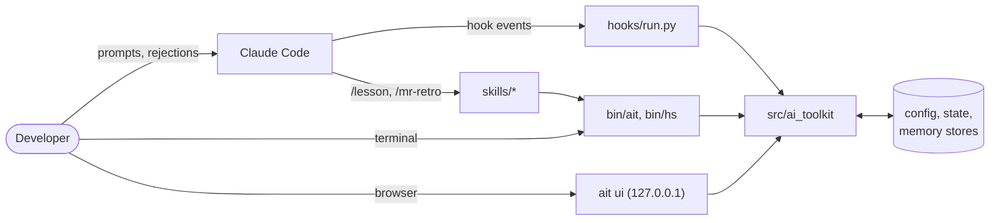

# Architecture

This page covers the shape of the whole repo: how it plugs into Claude Code, how the code is organized, where data lives, and the rules that keep features independent. How each feature works inside is on its own page: [lessons](features/lessons.md), [rules](features/rules.md), [setup](features/setup.md).

## The big picture



Claude Code is the host, and ai-toolkit never patches it. It integrates through one **Claude Code plugin** (the repo root is both the plugin and its marketplace):

| Plugin part | File | What it does |
|---|---|---|
| Manifest | `.claude-plugin/plugin.json` | Name, version, description |
| Marketplace | `.claude-plugin/marketplace.json` | Lists this repo (`"source": "./"`) as the one plugin, so `claude plugin marketplace add <repo>` works |
| Hooks | `hooks/hooks.json` | Each hook is one line: `python3 "${CLAUDE_PLUGIN_ROOT}/hooks/run.py" <feature>.<hook>` |
| Skills | `skills/<name>/SKILL.md` | `/lesson` and `/mr-retro`. They call `hs` and `ait` |
| Executables | `bin/ait`, `bin/hs` | On the Bash tool's PATH while the plugin is enabled, so skills can call them. Link them into `~/.local/bin` to use them in your own terminal |

Claude Code runs a plugin from **its own copy**, made at install time under `~/.claude/plugins/cache/`, even when the marketplace is a local folder. `bin/ait` linked from a clone runs the clone, but hooks and skills run the copy. After changing hook or skill code, run `claude plugin update ai-toolkit@ai-toolkit` and start a new session; `ait doctor` reports when the copy differs from the checkout.

## Code layout

```
src/ai_toolkit/
  cli.py              `ait`: builds the root parser; each feature adds its own group
  core/               shared and feature-agnostic; imports no feature
    paths.py          every on-disk location (config, state, Claude Code's folder)
    config.py         ~/.config/ai-toolkit/config.json, one section per feature
    hookrun.py        the hook contract (below)
    plugin.py         is the plugin enabled? which hooks are registered?
    legacy.py         `ait migrate-legacy`: removes what a 0.1 install.sh left behind
    jsonio.py clock.py proc.py gitutil.py secrets.py
  lessons/            api.py · cli.py · hooks.py · config.py · queue, detect, turn, distill, curate, ...
  rules/              api.py · cli.py · inventory.py · checks.py · retro.py
  setup/              api.py · cli.py · ops.py · snapshot_tree.py · adapters/claude_code.py
  dashboard/          server.py (HTTP, read-only) · registry.py (which features it shows)
ui/                   the dashboard web app (Vite + React)
  src/shell/          frame, nav, theme, polling, error boundary
  src/sdk.ts          the contract a feature view imports as "@toolkit/ui"
  src/features/<f>/   one folder per feature view
tests/                mirrors src/: core/ lessons/ rules/ setup/ dashboard/ e2e/, plus support/ (fixtures, fakes)
```

### The import rule

`tests/core/test_architecture.py` enforces these rules:

1. **`core` imports no feature.** Anything two features need goes in `core`.
2. **Features meet only through `api.py`.** For example, `rules` reads lessons with `lessons.api.lessons_for(repo, langs)`; it never parses the lesson Markdown itself.
3. **Nothing in `src/` edits `sys.path`.** Only the three entry points do, once each: `bin/ait`, `bin/hs` and `hooks/run.py`.

Every feature has the same shape:

| File | Role |
|---|---|
| `api.py` | The public surface: `snapshot()` for the dashboard, plus whatever other features may call |
| `cli.py` | `register(parent)` adds the feature's `ait <feature> ...` group |
| `hooks.py` | Only if the feature has hooks: one function per hook, taking the payload dict |

### Constraints

- **Standard library only, Python 3.9+.** Hooks can run under macOS `/usr/bin/python3` (3.9), and avoiding dependencies means the plugin works from a plain git checkout. CI tests on 3.9 and 3.13.
- **Hooks must be fast.** SessionStart has a 0.5 s budget, and a test checks it. Hooks don't call the network or an LLM; distill runs afterwards in a detached process.

## The hook contract

`hooks/run.py lessons.capture_prompt` → `core/hookrun.py`:

1. If `AI_TOOLKIT_DISABLE=1`, or the feature has `"enabled": false`, it does nothing.
2. It parses stdin as JSON (`{}` if stdin isn't JSON) and calls `ai_toolkit.<feature>.hooks.<hook>(payload)`.
3. Any exception is appended to `~/.local/state/ai-toolkit/<feature>/<feature>.log`.
4. It **always exits 0**, so a bug never blocks or breaks a Claude Code session.

A hook's stdout is passed back to Claude Code, which is how `session_start` returns `additionalContext`.

## Data locations

| What | Where | Owner |
|---|---|---|
| Settings | `~/.config/ai-toolkit/config.json` (sections `lessons`, `rules`, `setup`) | `core.config` |
| Machine-local state | `~/.local/state/ai-toolkit/<feature>/` | `core.paths.state_dir` |
| Lesson memory | the stores' git repos (default `~/.ai-memory/personal`) | lessons |
| setup snapshots | `setup.snapshot_dir` (a private git repo) | setup |
| Claude Code's files (read-only, except for `ait setup apply` and `migrate-legacy`) | `$CLAUDE_CONFIG_DIR` or `~/.claude`, and `~/.claude.json` | `core.paths.claude_dir` |

The plugin's own data folder (`${CLAUDE_PLUGIN_DATA}`) is deliberately left unused, because Claude Code deletes it on uninstall and memory must survive that. The [configuration reference](reference/config.md) lists every key and environment variable.

## Dashboard

`ait ui` serves `ui/dist` and a JSON API on `127.0.0.1` only. It rejects requests whose `Host` header isn't local, to block DNS rebinding, and it has no endpoint that writes.

| Endpoint | Returns |
|---|---|
| `GET /api/features` | enabled features from `dashboard/registry.py`: `[{name, title, tagline}]` |
| `GET /api/features/<name>/snapshot` | that feature's `api.snapshot()` |

Each snapshot is built in-process on its own thread, with a 30 s timeout. A slow or failing feature returns 504 or 502 for its own card, and the other features keep working. The shell polls every 3 seconds and highlights what changed, using each view's `freshKeys`. The web app mounts `ui/src/features/<name>/index.tsx` by folder name, so to show a feature it needs an entry in `registry.py` and a folder under `ui/src/features/`.

## Upgrading from 0.2

In 0.3 the `hindsight` feature became `lessons`. Nothing needs doing by hand:

- a `"hindsight"` config section is read until the next save, which writes `"lessons"`;
- `~/.local/state/ai-toolkit/hindsight/` is renamed to `.../lessons/` on first use. Claude Code keeps running its old copy of the plugin until `claude plugin update`, so anything that copy still queues in the old folder is appended to the new queue;
- `ait hindsight`, `hindsight.<hook>` hook targets and the `HINDSIGHT_*` variables still work. `hs` is unchanged.

## Upgrading from 0.1

0.1 was installed by `install.sh`, which wrote hook entries into `~/.claude/settings.json` and symlinks into `~/.local/bin`, `~/.claude/commands` and `~/.claude/ai-toolkit`. Those old paths no longer exist in 0.2, so a 0.1 machine has to switch to the plugin ([getting started](getting-started.md#upgrading-from-01)). What carries over by itself:

- `core.config` reads the old `hindsight.json` and `setup.json` until the first save.
- The lessons feature moves its old state folder to the new location on first use.

`ait migrate-legacy` (`core/legacy.py`) removes the old hook entries and links, and `ait doctor` reports any that are left.
