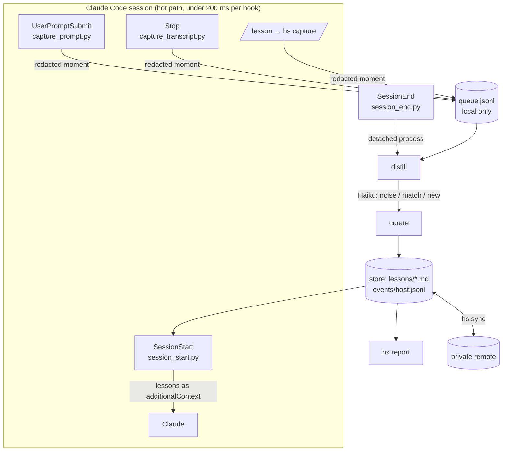
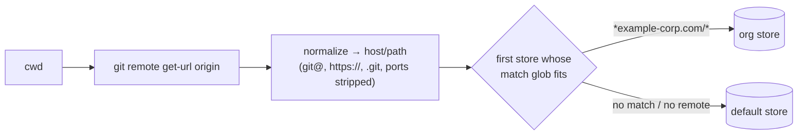

# lessons

Self-improving memory for Claude Code. It captures the moments where you push back on Claude, distills them into a small curated set of lessons, injects only the relevant ones at session start, and measures whether repeat pushbacks drop.

| Stage | What |
|---|---|
| Capture | Correction prompts, what you add when you send a request again, rejected tool uses and `/lesson` are written to a local queue |
| Distill | SessionEnd → background `claude -p --model haiku` turns moments into candidate lessons (rule fallback) |
| Curate | Merge duplicates, promote after hits in 2 sessions, retire unused/ineffective, cap 50/scope, `hs review` |
| Inject | SessionStart loads lessons for this repo, its languages, and global ones (≤15 lines) |
| Measure | `hs report`: pushbacks/session by week, before→after efficacy per lesson, detector precision |

## The loop

```
you push back ──► capture (UserPromptSubmit / Stop) ──► local queue (redacted clause only)
                                                            │ SessionEnd
                                                            ▼
          inject ◄── active/*.md ◄── curate ◄── distill (Haiku: match existing or propose new)
   (SessionStart)                  promote at 2 sessions · merge · retire · cap
          │
          └── events/<host>.jsonl ──► hs report (did repeats drop after activation?)
```

## Editing lessons

Lessons are plain Markdown in each store's `lessons/` folder. Edit the text, change `status:`
(candidate → active → retired/dismissed), or delete a section. The next curate run:
- marks hand-edited lessons `pinned`, so they are never rewritten, merged away or auto-retired;
- moves sections to the right file when you change `status:`, and records that as your decision;
- logs deletions.

`hs edit [ID]` opens the right file in `$EDITOR`. Every change is a git commit in the store.

## How efficacy is measured

For each active lesson, the lessons feature counts pushbacks matched to it per *relevant* session (same repo, same
language, or any session for global lessons), before and after activation. A lesson with ≥5 injected
sessions whose rate didn't drop is flagged ⚠ and retired (unless pinned).

A lesson you had to repeat in two or more sessions where Claude already had it is flagged **make it a
hook**: showing Claude the text was not enough, so the rule needs a hook to enforce it. It stays active.

Only sessions you took part in are counted (SessionStart ran, or a lesson was injected, or a pushback was
captured). Headless runs, such as SDK jobs and `claude -p`, only log a SessionEnd and are left out.

Caveat: lessons are created *because* of pushbacks, so "before" rates are biased upward
(regression to the mean). Trust the trend over many sessions more than any single lesson's number.

## Where things live

| What | Where | Synced? |
|---|---|---|
| Code | this repo | public git |
| Settings | `"lessons"` section of `~/.config/ai-toolkit/config.json` | never |
| Queue, offsets, caches, log | `~/.local/state/ai-toolkit/lessons/` | never |
| Lessons + events | memory stores, e.g. `~/.ai-memory/{personal,org}` | manual `hs sync` to each store's private remote |

**Routing:** each correction goes to the store whose `match` glob fits the normalized git remote of the repo you were working in (e.g. `*example-corp.com/*` → `org`). Anything else goes to the default store. Org knowledge never lands in your personal memory repo.

## Privacy

- Raw prompts are never stored. For a correction prompt, only the sentences that carried the correction signal are kept (≤200 chars). For a request you sent again, only the words you added are kept (≤200 chars).
- To learn *why* you pushed back, the local queue also keeps a short summary of the agent turn you corrected: your previous request (≤300 chars), its tool calls (file names, commands cut to 80 chars) and its last reply (≤300 chars). It is redacted, never synced, and deleted after distill; stores keep only the abstract `issue` and `why`. Turn it off with `"capture_context": false` in the `lessons` section of `~/.config/ai-toolkit/config.json`.
- Everything is redacted before it is written: API keys and tokens, JWTs, AWS keys, `password=`-style values, emails, URL credentials, and `$HOME` → `~`.
- For rejected tool uses, the tool name, file extension, a one-line summary of the call (file name, or the command cut to 80 chars) and your typed feedback are kept. Never the diff. `"capture_context": false` drops the call summary too.
- Hooks no-op when `AI_TOOLKIT_DISABLE=1`, or with `"enabled": false` in the `lessons` config section.

## CLI (`ait lessons`, or `hs` for short)

```
hs status | queue                      what's captured and where it routes
hs capture "text"                      explicit lesson (what /lesson uses)
hs distill [--dry-run] [--no-llm]      process the queue now (normally automatic at SessionEnd)
hs backfill [--dry-run] [-v]           re-derive queued moments from their transcripts with current capture rules
hs curate [--store S]                  merge / promote / retire / cap now
hs list [--status all|active|…] [--here]
hs show ID                             lesson + stats
hs edit [ID] · hs rm ID                edit in $EDITOR (pins it) · delete permanently
hs promote|retire|dismiss|restore ID
hs review [--list]                     triage candidates + auto-promoted lessons
hs inject [--cwd DIR]                  preview what SessionStart would inject
hs report [--repo here] [--weeks 8] [--json]
hs store list|init|add                 e.g. hs store add org --match '*example-corp.com/*' --remote git@…:me/ai-memory.git
hs sync [STORE]                        secret scan → commit → pull --rebase → push (manual only)
hs doctor                              health check (`ait doctor` adds the plugin check)
hs purge --queue | --local | --store S
```

## Dashboard

the Lessons section of `ait ui` (see [the dashboard](../architecture.md#dashboard)) is a live, read-only view of the
whole pipeline: stage health (capture → queue → distill → curate → store → inject), which hooks are registered (and
whether through the plugin or a pre-0.2 install), and lessons per store with their efficacy. **Queue → Inbox** shows
each raw pushback in plain words (what you corrected or rejected, and what Claude was working on). **Queue →
Processed** shows what each one became after distill: a lesson, or noise. **In Claude's context** shows exactly what
SessionStart injects for each repo you've worked in. Events, the report and `lessons.log` are there too. It refreshes
every 3 seconds and highlights what's new.

```bash
ait ui --feature lessons
ait snapshot lessons --pretty   # the JSON the view renders
```

The view's source is `ui/src/features/lessons/`; the snapshot is built by `src/ai_toolkit/lessons/snapshot.py`.

## Internals

How the lessons feature works inside, for contributors. The repo-wide shape (plugin, package, data locations) is in [architecture.md](../architecture.md).

### 1. Goals and constraints

The lessons feature is self-improving memory for Claude Code. It learns from the moments when the developer pushes back on Claude, and it shows with data whether that learning reduces repeat pushbacks.

| Constraint | How the design meets it |
|---|---|
| Curated memory, not a dump | Corrections become *candidate* lessons. They only take effect once the same correction shows up in two separate sessions. Near-duplicates are merged. Each scope holds at most 50 active lessons. Lessons that go unused, or don't help, are retired. |
| The developer can see, edit and delete every lesson | Lessons are plain Markdown in a git repo. Hand edits are detected and respected (the lesson is pinned). `hs` has a command for every lifecycle action. |
| No secrets or raw prompts stored | Only the sentence that carried the correction is kept (≤200 chars). It is redacted before it is written. Rejected tool uses keep the tool name, file extension and a one-line summary of the call (file basename or the command cut to 80 chars), never the diff. A short redacted summary of the agent turn being corrected stays in the local queue only and is deleted after distill; stores get only the abstract `issue` / `why`. `hs sync` scans for secrets and refuses to push if it finds any. |
| Local single-developer prototype | Python 3.9 standard library only, plus git and the `claude` CLI. State lives under `~/.claude`, `~/.config` and `~/.local/state`. |
| Portable, with memory kept apart from code | The code repo is public and contains no data. Memory lives in separate private git repos, and each repo's lessons go to a store chosen from its git remote. |

**Non-goals for the prototype:** sharing lessons across a team, real-time sync, embeddings or vector search, and any UI that writes (the dashboard is read-only).

### 2. System context

```mermaid
flowchart LR
  dev([Developer]) -- prompts / rejects edits --> cc[Claude Code]
  cc -- hook events --> hs[lessons hooks]
  hs -- additionalContext --> cc
  hs -- claude -p --model haiku --> haiku[(Haiku)]
  hs <--> stores[(Memory stores<br/>git repos)]
  stores -- hs sync --> remotes[(Private remotes<br/>org / personal)]
  dev -- hs CLI / $EDITOR --> stores
```

Claude Code is the host. The lessons feature never patches it. It integrates only through:
- **hooks** declared in the plugin's `hooks/hooks.json`;
- **one skill**, `/lesson` (`skills/lesson/SKILL.md`);
- **headless `claude -p`** calls during distill.

### 3. The loop



There are two paths:
- **Hot path:** the four hooks run synchronously inside the session. They use regex only, make no network calls, and can never block Claude.
- **Cold path:** distill and curate run in a detached background process after the session ends. These are the only steps that call the LLM.

#### 3.1 Capture

| Source | Hook | What is recorded |
|---|---|---|
| Typed correction ("no, use pnpm instead of npm") | UserPromptSubmit | the sentences that triggered the detector, the signals that fired, the repo/store/langs, `after_edit`, and the agent-turn `context` |
| Rejected tool use | Stop | tool name, file extension, `rejected` (the call itself, e.g. `Bash: pnpm tsc --noEmit` or `Edit App.tsx`), the typed rejection reason (the text between `the user said:` and `Note:`), and the agent-turn `context`. Only `is_error` tool results that *start with* the rejection message count, so output that merely quotes it (reading its own source) is ignored. |
| `/lesson <text>` | CLI `hs capture` | the lesson text, `kind: explicit` |

**Detector** (`detect.py`). Each regex signal has a weight, and a prompt counts as a correction when the total reaches **2.0**. Examples:
- leading `no,` scores 2.0;
- `use X instead` scores 2.5;
- `I said` / `I told you` scores 2.5;
- `why did you` scores 2.0;
- a bare `instead` scores 1.0.

Negative patterns are removed before scoring, for example "no problem", "no-op", "don't know", "thanks". Prompts that start with `/` are skipped. In prompts longer than 1500 characters, only the first 500 are scanned.

Each signal is recorded, and Measure uses this to report how precise each signal is.

**A request sent again** (`turn.py`, signal `resend`). Developers often stop the agent and send the same request again with the constraint they left out ("… Do not commit the changes"). When a prompt keeps at least 90% of the previous prompt's words in order and adds three or more, only the added words are queued, with `resend: true`. Tool calls rejected without a reason between the two prompts are not queued (or are removed if the Stop hook already queued them): stopping the agent to rephrase is not a pushback on those calls. Distill keeps the addition when it is a standing preference and marks it noise when it is a detail of that one task. `hs report` shows the precision of `resend` next to the other signals.

**Feedback on an implementation.** Right after the agent edits files, the next prompt is often feedback on that work even without a "no" ("the import is broken now, it should be a named import"). When the previous agent turn used `Edit`, `Write`, `MultiEdit` or `NotebookEdit`, the threshold drops to **1.0**, and three weak signals exist for this: `broken` ("doesn't work", "broke", "still failing", 1.5), `should_be` ("it should…", 1.0) and `missing` ("is missing", 1.0). Distill's LLM marks the follow-ups that are really new requests as noise.

**Agent-turn context** (`turn.py`). For every captured moment, the hook reads the last 512 KB of the transcript (about 4 ms on a 2.3 MB transcript). It finds the turn being corrected: the last prompt the developer typed before this one (skipping tool results, task notifications, `[Request interrupted…]` markers, meta entries and sidechains, and the current prompt if it is already written). It records:
- `request`: what the agent was asked (≤300 chars);
- `actions`: its tool calls as `Edit package.json` or `Bash: npm install lodash` (file basenames only, commands ≤80 chars, at most 8; when there are more, the latest are kept, since they are what the developer reacted to);
- `reply`: the last thing it said (≤300 chars);
- `edited`: whether it changed files.

All of it is redacted and goes only to the local queue. Set `"capture_context": false` in the config to keep the lower threshold but drop the context and the `rejected` call summary.

**Backfill** (`hs backfill`). When capture rules improve, moments already in the queue can be re-derived from their transcripts (`~/.claude/projects/*/<session_id>.jsonl`). Rejections are found by `tool_use_id`; prompts by re-running the detector on each typed prompt and matching the redacted clause. Moments that turn out not to be rejections are dropped; repeats across sessions stay, since they are promotion evidence; moments whose transcript is gone are kept unchanged. It is idempotent and holds distill's run lock, because a distill working from a snapshot would otherwise distill the unrefined moments and then drop the refined ones by id.

**Transcript scanning** is incremental. `offsets.json` stores a byte offset per transcript. A partial final line is re-read on the next Stop. The offsets table is pruned once it has more than 200 entries. On a 47 MB transcript, the first scan takes about 0.4 s and later scans take about 0.13 s.

**Queue entry** (`~/.local/state/ai-toolkit/lessons/queue.jsonl`):
```json
{"id":"…","ts":"…","session_id":"…","kind":"prompt|rejected_tool|explicit",
 "clause":"no, use pnpm instead of npm","signals":["lead_no","use_x_instead"],
 "repo":"gitlab.example-corp.com/team/web","store":"org","langs":["js"],
 "tool":"Edit","file_ext":".json"}
```
Every append takes an `fcntl` lock. The entry id is a short content hash, so if a hook fires twice the moment is stored once.

#### 3.2 Distill

The `session_end` hook writes a `session` end event. If the queue is empty and a background run started in the last 24 hours, it stops there, so headless sessions don't each start a process. Otherwise it starts `python -m ai_toolkit the lessons feature distill --quiet` in a new process session with `AI_TOOLKIT_DISABLE=1`, so the nested `claude -p` doesn't trigger its own hooks. The hook returns immediately.

`distill.py` works like this:
1. Takes a **non-blocking run lock**. If another distill is already running, this one exits.
2. Snapshots the queue. If a rejection with no typed feedback is followed within 600 s by a correction prompt in the same session, the two are **pre-merged** into one moment.
3. Groups moments by **store**, then by **repo**. For each group it calls Haiku once. The input is the moments plus the existing lessons that apply to this repo or its languages (ID and text only). For each moment, Haiku returns one of:
   - `noise`;
   - `match` = an existing lesson ID;
   - `new` = a proposed lesson: `text` (imperative sentence of at most 120 characters), `issue`, `why`, scope, keywords, file globs and confidence.

   The prompt asks Haiku to reason like a post-mortem, using the `context`: first the **issue** (what the agent concretely did wrong), then the **why** (the general cause, meaning the assumption or missing check behind it), then the **rule** that would prevent the whole class of mistake rather than patch one instance. `issue` and `why` are one abstract sentence each (≤160 chars, redacted).

   Proposals with confidence below 0.5 are dropped.
4. **Fallback:** if the LLM call fails or its output can't be parsed, rule templates produce lessons such as `Use X instead of Y`, `Don't …` and `Never …`.
5. A new lesson is first checked against live lessons in the same scope with Jaccard similarity of at least 0.6. If one matches, the moment counts as a hit on that lesson and no new lesson is created. If the proposed lesson has the id of a lesson that *curate* retired (unused, ineffective or over the cap), it is revived as a candidate (`restore` event, `by=auto`, `status=candidate`). Its hit count starts over, so it has to recur in new sessions before it is injected again. A lesson you retired or dismissed yourself stays that way.
   A `lang:` scope is accepted only for a language detected in the repo; anything else falls back to the repo scope. Scopes become file names, so they are also sanitized to a single path component.
6. Writes a `moment` event for every moment. The event holds the session, repo, kind, signals, noise flag and attributed lesson. **It does not include the clause text.**
7. Before changing anything, runs curate's hand-edit detection on the files as loaded, so edits made since the last run are pinned before distill records new hashes.
8. Saves the Markdown and commits to the store. It then removes that store's moments from the queue under the queue lock; moments that arrived while distill was running stay. This happens *before* curate, so a curate failure can never make the next run count the same moments twice.
9. Runs curate. A curate failure is logged and retried on the next run.

The headless call is:
```
claude -p --model haiku --output-format json --tools "" --no-session-persistence
       --strict-mcp-config --disable-slash-commands
       --settings '{"disableAllHooks": true}' --system-prompt <SYSTEM>
```
`--bare` isn't used because it breaks OAuth logins. A typical call takes about 4 s and costs about $0.0002. Setting `AI_TOOLKIT_LLM_CMD` swaps in any other command; the tests use this for a fake LLM.

#### 3.3 Curate

`curate(store)` runs after every distill. You can also run it with `hs curate`; `--dry-run` reports the actions without writing events, files or caches. Its passes run in this order:

1. **Hand-edit detection.** The content hash and status of each lesson are compared with `lesson_hashes.json` from the last run.
   - An edited lesson becomes `pinned` (`edit` event).
   - A status changed by hand becomes a `promote`, `retire`, `dismiss` or `restore` event with `by=user`.
   - A section that has disappeared becomes a `delete` event.
2. **Local merge.** A candidate whose text has Jaccard similarity of at least 0.6 with an older or active lesson in the same scope is folded into it (`merge` event, so its hits follow it).
3. **LLM consolidation.** This runs only when a store has more than 30 candidates. One Haiku call groups candidates that express the same rule in the same scope.
4. **Promote.** A candidate is promoted once it has hits in at least `promote_at` (2) *distinct sessions*. Repeating yourself within one session doesn't promote a lesson.
5. **Retire.** A lesson is retired if it hasn't been hit, injected or activated for `retire_days` (60), or if it is flagged ineffective (see 4.5).
6. **Cap.** Each scope keeps at most `cap_per_scope` (50) active lessons. When a scope is over the cap, the lessons with the fewest hits and the oldest last hit are retired first.

Pinned lessons are never merged away, rewritten or retired automatically.

Afterwards curate does the following:
- saves the Markdown;
- refreshes `lesson_hashes.json`, `rank_cache.json` (hits per active lesson, used by inject) and `unreviewed.json` (auto-promoted lessons you haven't reviewed yet, which drives the review nudge);
- makes one git commit.

`hs review` is interactive triage of candidates and newly promoted lessons: promote, keep, dismiss with a reason, edit or skip. Each decision is written as a `review` event.

#### 3.4 Inject

`session_start.py` runs once per session:
1. `repo_info(cwd)` returns the normalized remote, the repo root, and the languages detected from marker files (`package.json`→js, `pyproject.toml`→python, …).
2. It reads only the relevant active files from every local store: `active/global.md`, `active/repo-<slug>.md` and `active/lang-<x>.md`. Other scopes are never parsed.
3. It removes duplicates by text, then scores each lesson:

   | Signal | Score |
   |---|---|
   | Hits (from the rank cache) | +1 per hit |
   | Repo scope | +3 |
   | Lang scope | +1 |
   | A `files:` glob matches a file in the repo | +2 |
   | Pinned | +1 |

4. It adds the best-scoring lessons until it reaches **15 lines or 1500 characters**. A lesson too long for the remaining characters is skipped, and shorter ones below it can still fit.
5. It outputs:
   - `hookSpecificOutput.additionalContext`, a "Lessons from past corrections" block with one `- [L-xxxxxx] text` line per lesson;
   - a `systemMessage` the developer sees, e.g. `lessons: 4 lessons loaded · 1 newly promoted — run hs review`.
6. It writes `session` (start) and `inject` events to the store the current repo routes to. These are the denominator for the measurements.

Because each lesson is shown with its ID, Claude can cite it ("per your saved preference…"). The ID also links each injection to later pushbacks in the measurements.

#### 3.5 Measure

Stats are never stored. `stats.py` recalculates them every time by replaying the events from every host and every store. `alias_map` follows merge chains, so events recorded against a lesson that was later merged count toward the lesson that absorbed it.

For each lesson:
- **Relevant sessions:**
  - all sessions for `global`;
  - sessions in the same repo for `repo:…`;
  - sessions where the language was detected for `lang:…`.
- **Before and after activation:** pushbacks matched to the lesson per relevant session, split at the activation time. Activation is a `promote` event, a `create` event with status active, or a `restore` back to active. A `restore` to candidate resets the lesson's hit sessions instead.
- **Repeats while injected:** pushbacks matched to the lesson in sessions where it was injected. This is the direct failure signal.
- **Prevented:** `max(0, before_rate − after_rate) × after_sessions`.
- **Flagged ineffective:** the lesson has been injected in at least 5 sessions, `before_rate > 0`, and `after_rate ≥ before_rate`. Curate then retires it.
- **Needs enforcement:** pushbacks matched to the lesson in at least 2 sessions where it was injected. The report and dashboard show "make it a hook". Curate does not retire it for this.

Sessions that only have an end event (headless runs) are excluded from every count above and from the weekly rate.

`hs report` shows:
- weekly pushbacks per session as ASCII bars, with a trend arrow;
- the efficacy table;
- counts by status;
- detector precision per signal (the share of each signal's moments that distill did *not* mark as noise);
- dismissal reasons.

**Known bias.** Lessons are created *because* pushbacks happened, so a lesson's "before" rate is biased upward (regression to the mean). The fleet-wide weekly trend is the more honest headline. Treat the numbers for any single lesson as directional.

### 4. Data model

#### 4.1 Memory store (one git repo each)

```
<store>/
  README.md
  lessons/
    candidates.md                 status: candidate
    active/global.md              status: active, grouped by scope
    active/repo-<host__path>.md
    active/lang-<lang>.md
    archive.md                    status: retired | dismissed
  events/<hostname>.jsonl         append-only; one file per machine
```

**Lesson** (Markdown section; the `status` field decides which file it lives in):
```md
## L-abc494 — Use pnpm, never npm, in this repo
- scope: repo:gitlab.example-corp.com/team/web
- trigger: keywords=npm,install; files=package.json
- why: the repo is a pnpm workspace; npm ignores its lockfile
- issue: ran npm install right after being asked to add a dependency
- status: active
- created: 2026-10-31
- pinned: true
- reason: …              (when retired or dismissed)
- merged: L-123456       (absorbed lessons)
```
`why` and `issue` are optional and count toward the hand-edit hash only when set, so lessons written before these fields existed don't look edited. Inject appends `(why: …)` to the lesson line, which helps Claude apply the rule to cases the text doesn't name.

IDs are `L-` plus 6 hex characters of a hash of (store, text, scope). Two machines that learn the same lesson produce the same ID, and different lessons don't collide.

#### 4.2 Events

Every event has `t` (type) and `ts` (ISO UTC). The host is implied by the file it lives in (`events/<hostname>.jsonl`).

| `t` | Written by | Key fields |
|---|---|---|
| `session` | SessionStart / SessionEnd | session_id, repo, langs, phase (`start` or `end`) |
| `inject` | SessionStart | session_id, repo, ids |
| `moment` | distill | session_id, repo, kind, signals, tool, noise, lesson |
| `create` | distill | lesson, scope, status, source (llm / rules / explicit) |
| `promote` / `retire` / `dismiss` / `restore` | curate, CLI | lesson, by (auto / user / explicit), reason, hits |
| `merge` | curate | lesson, into |
| `edit` / `delete` | curate (hand edits), CLI | lesson |
| `review` | `hs review` | lesson, decision, reason |

**Why one events file per host:** each machine only ever appends to its own file. `git pull --rebase` therefore never sees a content conflict on events, and stats are a union over all of them. The Markdown files are the one place two machines can conflict, and git shows those conflicts in a form people can read.

#### 4.3 Local machine state (never synced)

| File | Purpose |
|---|---|
| `lessons` section of `~/.config/ai-toolkit/config.json` | stores (name, path, remote, match globs, default), promote_at, cap_per_scope, retire_days, inject budget, auto_promote, distill_model |
| `~/.local/state/ai-toolkit/lessons/queue.jsonl` | moments waiting for distill (redacted) |
| `offsets.json` | transcript byte offsets for the Stop hook |
| `lesson_hashes.json` | `{store: {id: {h, s}}}` used for hand-edit detection |
| `rank_cache.json` | `{store: {id: hits}}`, so SessionStart doesn't have to replay events |
| `unreviewed.json` | auto-promoted lessons not yet reviewed |
| `edited_rejections.json` | ids of tool calls rejected only so a request could be sent again; the Stop hook skips them |
| `distill_started.json` | when SessionEnd last started a background distill |
| `lessons.log`, `distill.out` | diagnostics |

### 5. Store routing



- **Writes** (moments, lessons, session and inject events) go only to the store the current repo routes to. That includes lessons with `global` scope: a global preference learned at work stays in the org store, so org knowledge never leaks into the personal remote.
- **Reads** (inject) merge every local store. A personal global lesson therefore applies at work too.
- Only the default store may match everything. A catch-all glob (`*`) on any other store is ignored by routing and flagged by `hs doctor`.
- **Sync** is manual and per store. `hs sync [store]` runs a secret scan, commits, runs `pull --rebase`, then pushes. If the scanner finds anything, the push is refused.

### 6. Privacy and security

Defense in depth, applied at each layer:

1. **Minimize at capture.** Only the sentences that fired the detector are kept, never the full prompt. For rejected tool uses, the diff is never read; the call is kept only as a one-line summary (file basename or command ≤80 chars), and only while `capture_context` is on.
2. **Redact before every write** (`redact.py`):
   - API keys: `sk-…`, `gh*_…`, `glpat-…`, `xox…`, `AIza…`;
   - AWS key IDs (`AKIA` / `ASIA`), JWTs and PEM private keys;
   - credentials embedded in URLs;
   - `key=value` / `key: value` secret assignments and bearer tokens;
   - emails and long hex or base64 blobs;
   - `$HOME`, which is replaced with `~`.
3. **No clause or context past the queue.** Stores hold lesson text, `why` and `issue`, which the LLM or the developer writes. They never hold the captured clauses or the agent-turn context (request, actions, reply). The queue is emptied after each distill.
4. **The LLM is told** not to put secrets, names, file contents or one-off task details into lessons.
5. **Pre-push gate.** `hs sync` runs `redact.scan()` over the whole store and refuses to push if anything matches.
6. **Purge.** `hs purge --queue | --local | --store S` wipes data.

The e2e test greps the stores and local state after a full lifecycle to confirm that the non-correction prompt text and the diff contents are absent.

### 7. Reliability and performance

- **Hooks never break Claude Code.** `core/hookrun.py` runs every hook: it logs any exception to `lessons.log` and always exits 0. With `AI_TOOLKIT_DISABLE=1` (or `"enabled": false`) the hooks do nothing.
- **Latency budget.** Prompt hooks take about 0.1–0.2 s, and SessionStart stays under 0.5 s (a test enforces this). The hot path has no network or LLM calls.
- **Concurrency.**
  - Queue appends and rewrites use an `fcntl` lock.
  - Distill takes a non-blocking single-run lock.
  - JSON state is written atomically (write to a temporary file, then `os.replace`).
- **Degradation.** If the LLM is unavailable, rules take over. If a store isn't initialized, it is created on first write. If a repo has no git remote, its moments go to the default store.
- **Auditability.** Every change the tool makes is a git commit in the store (`lessons: distill N moment(s)`, `lessons: curate (N changes)`). `git log` and `git revert` work as an undo history.

### 8. Testing

`make test` (or `uv run --python 3.9 --with pytest pytest tests/lessons tests/e2e tests/dashboard`) runs offline.
Each test gets, through `tests/support/lessons_env.py`:
- a temporary `HOME` with its own config, state and stores;
- a fixed clock (`AI_TOOLKIT_NOW`);
- a fake LLM (`AI_TOOLKIT_LLM_CMD`, with modes `ok`, `fail` and `garbage` via `FAKE_LLM_MODE`).

| Suite | Covers |
|---|---|
| lessons/test_capture | detector true and false positives, redaction, incremental transcript parsing, routing, dedupe, store init |
| lessons/test_turn | the agent-turn summary captured before a pushback, and the `why` / `issue` it lets distill write |
| lessons/test_distill | LLM path, rule fallback, explicit lessons, pre-merge, dry run, moments arriving while distill runs, no raw clauses in stores |
| lessons/test_curate | merge, promote at 2 sessions, retire by age, cap, pinned on hand edit, hand status changes, deletes, review |
| lessons/test_inject | scope selection, ranking, budget, cross-store reads, the CLI preview, SessionStart latency (< 0.5 s) |
| lessons/test_report | before/after efficacy, ineffective flag leading to retirement, weekly buckets, detector precision |
| lessons/test_resend | a request sent again: only the addition is queued, reasonless rejections on the way are dropped, typed reasons stay |
| lessons/test_backfill | dry run writes nothing; false positives dropped, rejected call and the right turn recovered, missing transcripts kept, second run a no-op; refuses while distill holds the run lock |
| lessons/test_lifecycle_edge_cases, test_status_edge_cases | hand edits vs distill, dry runs and failures that must write nothing, decisions the developer made by hand staying made, scope normalization, catch-all routing |
| e2e/test_plugin_lifecycle | every hook run through the exact command in `hooks/hooks.json` across 9 sessions; then report, privacy grep, sync to a bare remote, secret blocking, and `"enabled": false` turning the hooks off |
| dashboard/test_lessons_dashboard | `ait ui`: feature listing, unknown feature 404, stage health without the plugin (hook stages off, queue waiting then stalled), plugin-enabled hooks, the full loop landing lessons and events, the per-repo injected context, foreign `Host` rejected |

A manual live run with real Claude and Haiku in a sandbox reproduced the whole loop:
1. Claude used npm.
2. The developer pushed back in two separate sessions, and Haiku matched both to one lesson, which was then promoted.
3. Later sessions used pnpm unprompted.

Design decisions and the alternatives considered are in [docs/decisions](../decisions/0001-hindsight-design.md).

### 9. Limitations and future work

- **Detector recall.** Corrections without a typical phrasing (e.g. "hmm, prefer the other approach") are missed, though `/lesson` covers them. Per-signal precision in the report shows which weights to tune.
- **Efficacy attribution** is observational, with the regression-to-the-mean bias described in [Measure](#34-measure). A/B holdouts (randomly skipping a lesson's injection) would give causal numbers.
- **Trigger use.** Keywords are stored but injection only uses scope and file globs. Injecting per prompt (UserPromptSubmit with additionalContext on keyword match) is a natural next step.
- **Team sharing.** Stores are per developer. A shared, read-only team store with PR-based promotion would build on the existing routing and Markdown format.
- **Other features.** See [Adding a feature](../../CONTRIBUTING.md#adding-a-feature).
